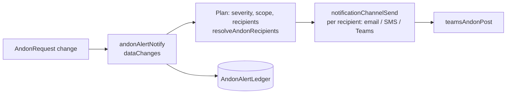
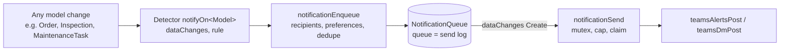

# 04. Event-driven patterns

Alerts in Fuuz are best driven by **events**, not polling timers. A business event writes or changes a row; a dataChanges trigger reacts within seconds. The same send step also works from any other Fuuz starting point: a flow or workflow step, a schedule (for digests and reminders), a threshold check, or an integration message.

| Pattern | Use when | Status |
|---|---|---|
| **A. Direct send** | Each event is already an alert, recipients come from a routing table, and you want the card within seconds | VERIFIED end to end (Andon reference: `andonAlertNotify` > `notificationChannelSend` > `teamsAndonPost`) |
| **B. Detect, queue, send** | Events need filtering, dedupe, bursts merged, per-person preferences, quiet hours or retries | The building blocks (dataChanges trigger on a queue row, mutex, post flow) are VERIFIED in a Fuuz production deployment; your own rules and models are TO VERIFY in your tenant |

---

## 1. The dataChanges payload

A dataChanges trigger node subscribes to a model and a list of operations:

```json
{ "type": "dataChanges", "data": { "api": "Application", "type": "<ModelName>", "operations": ["Create", "Update"], "nextNodes": ["n_keep"] } }
```

The payload the flow receives is:

```json
{ "value": { "before": { }, "after": { } } }
```

There is **no operation field** (VERIFIED). Work it out from `before` and `after`:

```
$has  := function($o) { $type($o) = "object" and $count($keys($o)) > 0 };
$opOf := function($b, $a) { $has($b) ? ($has($a) ? "update" : "delete") : ($has($a) ? "insert" : "none") };
```

- An insert has no `before`. A re-delivered insert of the same id arrives as an update, so a rule that fires "on insert only" never posts twice.
- For updates, compare `before` and `after` on the fields that matter (for example `status`, `assigneeUserId`). Ignore technical fields (`id`, `createdAt`, `updatedAt`, `updatedByUserId`, sync stamps, `customFields`, `dataChanges`).
- dataChanges flows run **asynchronously after the save commits**. A slow or failing detector cannot slow down or fail the user's save.

## 2. Pattern A: direct send (Andon reference, VERIFIED)



Rules that came out of production:
- **One post per channel per alert.** Several recipient rows that resolve to the same team and channel produce one card; the others are logged `suppressed` / `duplicate` in the ledger.
- **Per-recipient catch.** A Teams failure for one recipient must not stop e-mail or SMS for the others.
- **Select what you route on.** The recipient query must SELECT the Teams custom fields (`teamsTarget`, `teamsUpn`). When they were missing from the selection, every Teams recipient silently fell back to e-mail (VERIFIED incident). Add a test that every field the router reads is in the query's selection, and make your test mock return only the selected fields.
- **The route comes from server-side rows.** `teamsTargetOf(customFields, emails)` gives `{ target: "channel" | "dm", upn }`. A DM uses `teamsUpn` when set, else the recipient's e-mail. A channel recipient means "the channel of the Andon's own equipment", never a typed team.

## 3. Pattern B: detect, queue, send (generic)



### 3.1 Detector (one flow per trigger)

- Trigger: dataChanges on the model, operations as narrow as possible.
- A pure **decide** step: JSONata over `{ op, before, after, settings }` returns `{ go, reason, event }`. Keep it pure so it can be unit-tested offline.
- Wrap the enqueue call in a tryCatch. A detector only queues; it never posts.
- Example rules:

| Event | Rule |
|---|---|
| `recordCreated` | Insert only; skip test data and records created by service users (imports, syncs) |
| `stateChanged` | `before.status != after.status` and `after.status` is in a configured list (e.g. `onHold`, `rejected`, `complete`) |
| `recordAssigned` | `before.assigneeUserId != after.assigneeUserId` and the new value is not empty |
| `thresholdCrossed` | A numeric field rises past a configured value (`before.x < limit <= after.x`); once per record |
| `commentAdded` | Insert on a comment model linked to the record; bursts merge |

### 3.2 Enqueue

- **Recipients:** derived from the record (assignee, owner, creator, watchers), minus the **actor**. **Nobody is notified about their own change.** The actor is `after.updatedByUserId`, falling back to `createdByUserId`; whether `after` always carries `updatedByUserId` is **TO VERIFY** per model (if not, re-read the model's data-change record).
- **Domain allow-list:** DMs only to e-mail domains in a setting (`dmAllowedDomains`, e.g. the customer's own domains), so a mis-addressed card never goes outside.
- **Per-user preference:** a `UserNotificationPreference` row per user with `channel` = `teams` / `email` / `both` / empty (empty = the default in settings). Let users change it on a preferences screen, written only for the caller.
- **Dedupe key:** e.g. `event:model:recordId:user:<id>`. One pending card per event, record and person. Row id `nq_<key>_<minute>` with an **upsert**, so concurrent events in the same minute land on one row.
- **Bursts:** a new event updates the pending row (`burstCount + 1`, newest content wins). "Updated" DMs are leading-edge: the first sends at once; later ones within a window are named in the next DM.
- **Restricted records:** recipients without access get a **content-free** card (chapter 09).

### 3.3 The queue model

`NotificationQueue` (template: [templates/fuuz/notification-queue.model.json](templates/fuuz/notification-queue.model.json)):

`id, event, channel, recordType, recordId, recipientUserId, recipientEmail, actorUserId, dedupeKey, burstCount, firstEventAt, lastEventAt, notBefore, status, attempts, lastAttemptAt, nextAttemptAt, sentAt, httpStatus, error, card (JSON), redacted, restricted`

Statuses: `pending`, `sending`, `sent` (202), `retry`, `dead` (5 attempts), `expired`, `merged`, `superseded`.

### 3.4 Sender (triggered, no polling schedule)

- Trigger: **dataChanges on `NotificationQueue`, `Create`**. Every new row starts the sender within seconds (VERIFIED in a Fuuz production deployment).
- **Mutex** at the start (`mutexLock`, resource `"notificationSend"`) so only one sender reads and claims at a time.
- Reads due rows, **caps** at 20 per workflow per 5 minutes (Microsoft allows 25 Flow bot posts per 300 seconds per connection), **claims** each row (`sending`, `attempts + 1`) before posting, renders, posts, records the answer.
- **Consequence of no schedule:** a held card (burst window, quiet hours, retry back-off) goes out with the next queued card or a manual run. If you need timed retries, add a Delay node or one schedule, knowingly.

## 4. Switches and safe rollout

Keep these in one `ApplicationConfiguration` row, `teamsNotificationSettings`, assigned to the module that owns the notifications (template: [templates/fuuz/teamsNotificationSettings.applicationConfiguration.json](templates/fuuz/teamsNotificationSettings.applicationConfiguration.json)).

| Switch | Effect |
|---|---|
| `live` (boolean) | Nothing is queued or posted while `false`. Turning it off stops everything at once |
| `channelEvents`, `dmEvents` (lists) | Only listed events post. Ship new events unlisted; list them when approved. Defence in depth if a detector is switched on by mistake |
| Detector `active` flags | Deploy detectors **inactive**; activate one at a time |
| `pilotRedirectUpn` | When set, every card goes to this person as a DM, headline prefixed `[TEST for <real recipient>]`. In the Andon reference the same idea is a `[redirect]` recipient on the notification channel |
| `notificationTeams.enabled` (Andon reference) | `false` skips Teams recipients (logged) while e-mail and SMS continue |

Recommended go-live order: deploy everything inert > test the workflows alone > test one card through the post flow > pilot redirect on > `live` on > activate one detector > confirm in Teams > clear the redirect for that event.

## 5. Logging

- Triggered and scheduled flows log **failures only** (`executionStarted: false`, `executionSucceeded: false`, `executionFailed: true`, trace off). A busy detector otherwise fills the log.
- Post flows log no payloads at all (chapter 03).
- Set the flow log level to `Error` for triggered flows.

## 6. Settings

- Keep parameters in settings rows, not in flow code. Normalise on read so a bad hand edit falls back to the default and never fails a send.
- **Every ApplicationConfiguration row is assigned to the module that owns it.**

## 7. Pre-deploy checks that would have prevented production incidents

| Check | Incident it prevents |
|---|---|
| Every field a flow selects exists in the **live** schema (introspection before writing) | A detector selected a field the model did not have; every run failed (VERIFIED incident) |
| Every field the router reads is selected | Teams recipients fell back to e-mail (VERIFIED incident) |
| Node data keys are allowed (`teams-shared/nodeSchema.cjs`) | The post flow was refused at deploy for `transform: ""` on tryCatch (VERIFIED) |
| Judge "what is live" by `DataFlow.currentDeployment.dataFlowVersion`, not `DataFlowVersion.deployed` | A deploy tool skipped flows because an old draft carried `deployed: true` (VERIFIED) |
