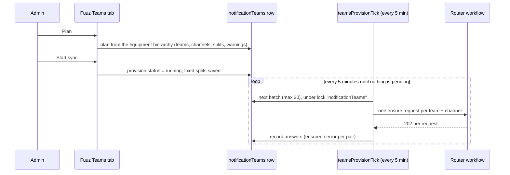

# 07. Provisioning teams and channels

Use this chapter when Fuuz posts to **channels derived from data** (the router workflow, `target = channel`). Reference implementation (Andon, tested): `fuuz/accelerators/isa95-pure-mes/screens/_shared/teamsTarget/teamsCore.mjs` and the "Sync Teams channels" action on the Notification Channels screen (Teams tab), sender flow `teamsProvisionTick`.

## 1. Names come from codes

The workflow matches names **exactly** and **creates on a miss**. A name that changes even once opens a second team or channel. So:

- Build names only from **codes** (site, area, line, work unit), never from descriptions people edit.
- Pass every name through one sanitiser (`teamsSafe`): ASCII only, none of `# % & * { } / \ : < > ? + | ' " ; ~`, single spaces, no leading or trailing dash or dot, channel at most 50 characters, team at most 80.
- One function computes the name for both the live alert and provisioning (`teamsScopeOf` > `teamsTeamOf` / `teamsChannelOf`), so a provisioned channel is exactly the channel an alert posts to.

Default scheme of the Andon reference (configurable per site in the `notificationTeams` row):

| Setting | Values | Default | Example |
|---|---|---|---|
| `team` | `siteArea`, `site` | `siteArea` | `Andon - DETROIT - ROLLFORM` |
| `channel` | `unit`, `workCenter`, `area` | `unit` | `RF01` |
| `prefix` | text, 30 characters | `Andon` | first word of every team name |
| `maxChannelsPerTeam` | 1 to 990 | 900 | split threshold |
| `batch` / `batchMinutes` | 1 to 20 / at least 5 | 20 / 5 | provisioning pace |
| `sites.<code>` | per-site `team` / `channel` override | none | |

**Changing the prefix, or a site's levels, starts new teams and channels.** The old ones stay. Say so in the settings UI.

## 2. Teams limits that shape the design

| Limit | Effect | Source |
|---|---|---|
| About 1,000 channels per team, **including deleted ones** until permanently removed | An area with very many work units splits into numbered teams: `... - ROLLFORM 2` | Teams limits (DOCUMENTED) |
| Flow bot cannot post in private channels | Create **standard** channels only | DOCUMENTED |
| New channels are hidden for members by default | Members must choose **Show**, or the owner sets the channel to show for everyone | VERIFIED behaviour |
| Teams allows duplicate team names | Two parallel creations give twin teams (section 5) | VERIFIED behaviour |

**Splits:** units are sorted by code. When a team would exceed `maxChannelsPerTeam`, the next code becomes the first channel of team 2. The split boundaries are **fixed** in the settings row (`splits`) when a provisioning plan is applied, so a unit never moves team when more units are added later. Only the last team of an area is split further.

## 3. Membership is the customer's job

A team the workflow creates is **private**, and its only owner is the workflow's service account. Fuuz adds nobody. Before go-live:
1. The customer's Teams administrator adds members (or a group) to each team. A dynamic Microsoft 365 group per site or area is the low-maintenance option.
2. Members show the channels they need, or the owner sets them to show by default.
3. Members set channel notifications to **All activity** for alert channels.

Until members are added, only the service account sees the cards.

## 4. Pre-provisioning: "Sync Teams channels"

Without pre-provisioning, the **first alert** to a new site or area waits about 5 minutes (create team, wait, install app, create channel, wait). Pre-provisioning moves that delay out of the alert path.

How it works (VERIFIED in the Andon reference implementation):
1. **Plan:** from every equipment Andons can be raised on, compute teams, channels, split areas and warnings (e.g. two units whose codes sanitise to the same channel name). Show the counts before anything is sent.
   [Screenshot: Teams tab showing the plan with team and channel counts and warnings]
2. **Start:** save the fixed split boundaries and set the sync to running.
3. **Send:** a flow on a 5-minute schedule takes the next batch (at most 20) of pairs not yet ensured and sends one `ensure` request each to the post flow. It records 202 as ensured and anything else as an error on that pair, shown on the tab. Idle ticks read nothing and log nothing.
4. **Done** when nothing is pending. Re-running later only sends pairs that are new.

This is the one place a schedule is used: provisioning is a paced background job, not an alert.

Throttle: about **20 ensure calls per 5 minutes**. Each ensure that creates something holds a workflow run for several minutes and creates Teams objects; going faster triggers Teams and connector throttling.

## 5. Twin teams and how to avoid them

Two runs that look for the same **new** team while the first is still creating it (create, 3-minute wait, app install) both miss it and both create one.

- **Sync never does this:** for a team the workflow must create, it sends **one** ensure first. That team's other channels follow 5 minutes after the first was accepted (`freshHoldMinutes`). A failed first ensure does not start the hold; the next tick tries again.
- **Live alerts can still race:** two alerts in a brand-new area within about 3 minutes. Prevent it by running Sync for an area **before** it goes live. Trigger concurrency 1 would also prevent it but delays every alert behind a 5-minute creation run.
- **Cleanup if it happens:** archive the newer twin in the Teams admin center, make sure the older one has the Workflows app, and re-run Sync.

## 6. Checklist for a new site or area

- [ ] Equipment codes final (no plan to rename)
- [ ] `notificationTeams` row reviewed: team and channel levels, prefix
- [ ] Plan reviewed: counts and warnings
- [ ] Sync started and finished with no errors
- [ ] Teams admin added members to each new team
- [ ] Channels shown for members; notifications set
- [ ] One test alert per area confirmed in Teams (walkthrough 01)
