# Integrating Fuuz with Microsoft Teams

**Accelerator:** channel posts and direct messages from Fuuz to Microsoft Teams
**Site:** https://accelerators.fuuz.com/teams-chat-accelerator/
**Audience:** Fuuz partners and customer integrators who build on Fuuz and own (or work with whoever owns) the customer's Microsoft 365 tenant.

> **Scope and disclaimer**
>
> - **Tested reference:** this pattern was built and tested **end to end in production for an Andon (production alert) scenario** in the Fuuz MES: alerts raised on equipment post to a channel per work unit and as direct messages to named people.
> - **Any event:** your team can implement the same approach for **any type of event in the Fuuz platform**: any model data change, a flow or workflow step, a schedule, a threshold or calculated condition, an integration message, and so on. The generic examples in this kit (walkthroughs 02 and 03) show how.
> - **Not yet proven:** items not proven in production are marked **TO VERIFY**. Test them in your tenant before you rely on them.
> - **Microsoft changes:** Microsoft Teams and Power Automate behaviour, limits and licensing can change. Validate them in your own tenant before go-live; the Microsoft links below were checked when this kit was written.

Each statement in this kit carries one of these marks:

| Mark | Meaning |
|---|---|
| **VERIFIED** | Observed working in production in a Fuuz deployment (the Andon reference implementation unless stated otherwise) |
| **DOCUMENTED** | Stated by Microsoft documentation (linked) but not exercised by us |
| **TO VERIFY** | A design we believe is correct but have not proven. Test it in your tenant before you rely on it |

---

## What you get

A Fuuz flow renders an **Adaptive Card**, wraps it in the Teams webhook message envelope, adds a small `fuuz` routing object, and POSTs it to a **Power Automate workflow** ("Workflows" in Teams). The workflow then does one of these:

| Target | What the workflow does |
|---|---|
| `dm` | Posts the card to one person in their 1:1 chat with the **Flow bot** |
| `channel` | Finds the team and channel **by exact name** and creates them if missing. It installs the Workflows app in a new team, waits until Teams is ready, then posts |
| `ensure` | Does the same find-or-create as `channel` but posts nothing. Use it to pre-provision teams and channels before go-live |

The Fuuz side never holds a Microsoft credential. The only secret is the workflow's trigger URL, and it is stored in a Fuuz **Connection**.

## Architecture

```mermaid
flowchart LR
  subgraph Fuuz tenant
    A[Event in Fuuz<br/>model data change, flow step,<br/>schedule, threshold] -->|e.g. dataChanges trigger<br/>async, after commit| B[Detector flow<br/>rule: insert? update? which fields?]
    B -->|enqueue, dedupe key| C[(NotificationQueue<br/>queue = send log)]
    C -->|dataChanges trigger on new row| D[Sender flow<br/>mutex, throttle, live switch]
    D --> E[Card renderer<br/>Adaptive Card 1.4 + fuuz routing]
    E --> F[Post flow<br/>quiet nodes, URL never logged]
    F -->|HTTPS POST| G[[Connection<br/>HTTP connector, URL = secret]]
  end
  G -->|202 Accepted| H
  subgraph Microsoft 365 tenant
    H[Power Automate workflow<br/>When a Teams webhook request is received] --> I{fuuz.target}
    I -->|dm| J[Post card as Flow bot<br/>Chat with Flow bot]
    I -->|channel / ensure| K[Find or create team<br/>install Workflows app<br/>find or create channel]
    K -->|channel| L[Post card as Flow bot<br/>in the channel]
  end
```

The Andon reference implementation uses the shorter **direct-send** variant: the alert flow calls the post flow directly for each recipient, without a queue. Both variants share the same card renderer, post flow, payload contract and workflow shape (chapter 04).

## When to use which pattern

| You need | Use | Chapter |
|---|---|---|
| One fixed channel for a whole function (Quality Alerts, Maintenance Alerts) | Fixed-channel workflow. The channel and team exist already, and the workflow only posts | 02, walkthrough 02 |
| A message to a named person | DM workflow (`dm`) | 02, 06, walkthrough 03 |
| Channels derived from your data (one per work unit, per line, per site) | Router workflow (`dm` / `channel` / `ensure`) with find-or-create, plus pre-provisioning | 02, 07, walkthrough 01 |
| Immediate alerts with recipients from a routing table | Direct send from the event flow (the Andon pattern) | 04 |
| Alerts that need filtering, dedupe, per-person preferences or retries | Detector, then `NotificationQueue`, then a data-change-triggered sender | 04 |
| Buttons that write back to Fuuz (Approve, Acknowledge in place) | Not available through Workflows webhooks. Use `Action.OpenUrl` to a Fuuz screen, or build a Teams bot (chapter 06, section 6) | 05, 06 |

## Chapters

| File | Contents |
|---|---|
| [01-concepts.md](01-concepts.md) | Vocabulary: Workflows, Flow bot, webhook trigger, the payload contract, what a 202 means |
| [02-setup-power-automate-workflows.md](02-setup-power-automate-workflows.md) | Click-by-click build of the three workflow shapes |
| [03-fuuz-connection-and-flows.md](03-fuuz-connection-and-flows.md) | The Fuuz Connection, the post flow, the send step, deep links |
| [04-patterns-data-change-driven.md](04-patterns-data-change-driven.md) | Event-driven alerts: direct send, or detector, queue and sender; dedupe, preferences, switches, pilots |
| [05-adaptive-cards-styling.md](05-adaptive-cards-styling.md) | Card layout, severity colours, size limits, light and dark testing |
| [06-bots-and-app-installation.md](06-bots-and-app-installation.md) | Getting the Flow bot into teams, group chats and 1:1 chats without manual steps |
| [07-provisioning-teams-and-channels.md](07-provisioning-teams-and-channels.md) | Naming from codes, splits, pre-provisioning ("Sync Teams channels"), twin teams |
| [08-operations-limits-troubleshooting.md](08-operations-limits-troubleshooting.md) | Limits, throttling, run history, an error table, rotation |
| [09-security.md](09-security.md) | Secrets, logging, restricted content, ownership, least privilege |
| [walkthroughs/](walkthroughs/) | 01 Andon alerts to a work-unit channel (tested reference); 02 notify a channel when a record changes state; 03 DM the assigned user; 04 end-to-end test |
| [templates/](templates/) | Workflow definitions (code view), the payload JSON Schema, card templates, Fuuz settings and model examples |

## Fastest path (about 1 hour)

1. Read [01-concepts.md](01-concepts.md) (10 minutes).
2. Build the DM workflow and a fixed-channel workflow ([02](02-setup-power-automate-workflows.md), 20 minutes).
3. Create the Fuuz Connection, paste the URL, and build the post flow ([03](03-fuuz-connection-and-flows.md), 15 minutes).
4. Send the test body in [templates/fuuz/test-request-body.json](templates/fuuz/test-request-body.json) and confirm the card in Teams ([walkthrough 04](walkthroughs/04-end-to-end-test.md)).
5. Add a detector for your first business event ([04](04-patterns-data-change-driven.md), [walkthrough 02](walkthroughs/02-channel-on-record-state-change.md)).

## Recommended tools

Build Fuuz flows, screens and models with **VS Code and the Fuuz extension**. The flow definitions in this kit are written so they can be versioned in a repo and deployed by script. Power Automate workflows are built in the Power Automate designer; [templates/power-automate/](templates/power-automate/) holds their code-view definitions for review and comparison.

## Microsoft references

- [Microsoft Teams connector reference](https://learn.microsoft.com/en-us/connectors/teams/): actions, operation ids, throttling, known issues
- [Create incoming webhooks with Workflows for Microsoft Teams](https://support.microsoft.com/en-us/teams/apps-service/create-incoming-webhooks-with-workflows-for-microsoft-teams)
- [Incoming webhooks and Workflows: sending messages](https://learn.microsoft.com/en-us/microsoftteams/platform/webhooks-and-connectors/how-to/connectors-using)
- [Cards reference for Teams](https://learn.microsoft.com/en-us/microsoftteams/platform/task-modules-and-cards/cards/cards-reference)
- Microsoft Graph app installation: [in a team](https://learn.microsoft.com/en-us/graph/api/team-post-installedapps), [in a chat](https://learn.microsoft.com/en-us/graph/api/chat-post-installedapps), [for a user](https://learn.microsoft.com/en-us/graph/api/userteamwork-post-installedapps)
- [App setup policies](https://learn.microsoft.com/en-us/microsoftteams/teams-app-setup-policies) and [installing apps for users](https://learn.microsoft.com/en-us/microsoftteams/install-teams-apps)

